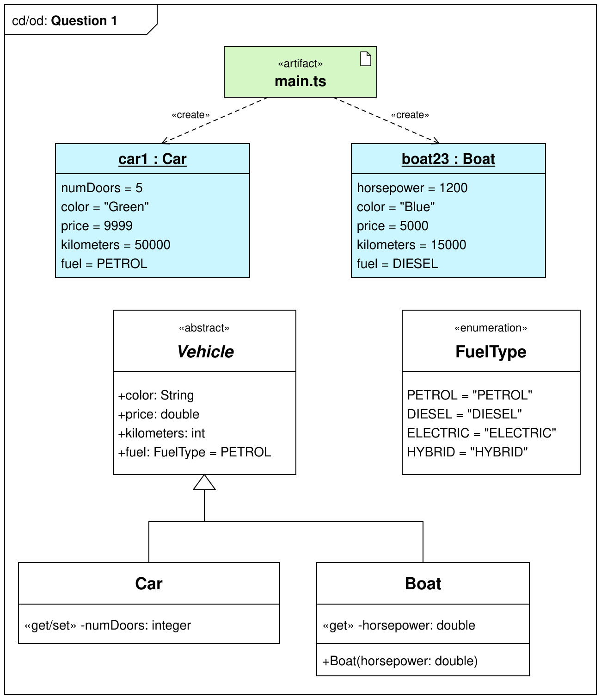

# Lab test - Question 1

Write (correct) TypeScript code in `/src` to implement the classes/objects in the provided UML diagram.

Write console.log statements at the end of `/src/main.ts` to dump out the contents of each object:
```bash
car1 =
Car {
  color: "Green",
  price: 9999,
  kilometers: 50000,
  fuel: "PETROL",
  numDoors: 5
}


boat23 =
Boat {
  color: "Blue",
  price: 5000,
  kilometers: 15000,
  fuel: "DIESEL",
  horsepower: 1200
}
```


