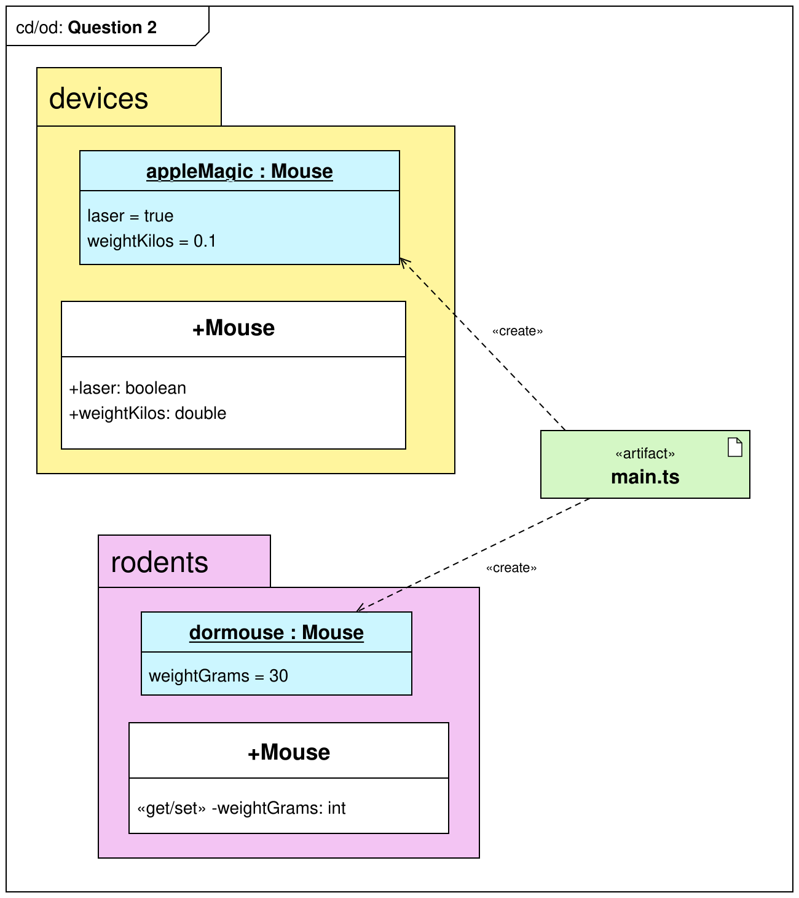

# Lab test - Question 2

Write (correct) TypeScript code in `/src` to implement the classes/objects in the provided UML diagram.

Write console.log statements at the end of `/src/main.ts` to dump out the contents of each object:
```bash
appleMagic =
Mouse { laser: true, weightKilos: 0.1 }


dormouse =
Mouse { weightGrams: 30 }
```


