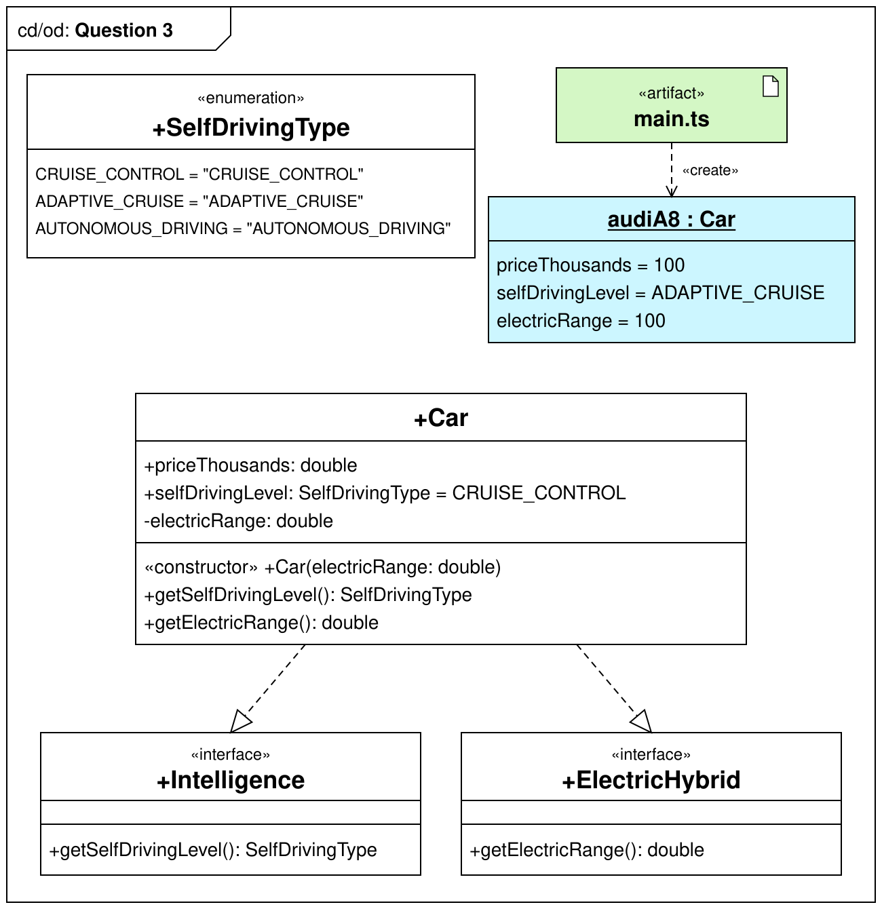

# Lab test - Question 3

Write (correct) TypeScript code in `/src` to implement the classes/interfaces/objects in the provided UML diagram.

> **Marking:** only your `/src` folder is marked. It is run against the lecturer's own copy of the tests, so do not
> change the files in `/tests` to make them pass - write code in `/src` that passes them. See
> `README_TypeScript_correctness.md` for the seven checks your code must pass, including 100% test coverage (step 7).

Write console.log statements at the end of `/src/main.ts` to dump out the contents of the object:
```bash
audiA8 =
Car {
  priceThousands: 100,
  selfDrivingLevel: "ADAPTIVE_CRUISE",
  electricRange: 100
}
```


